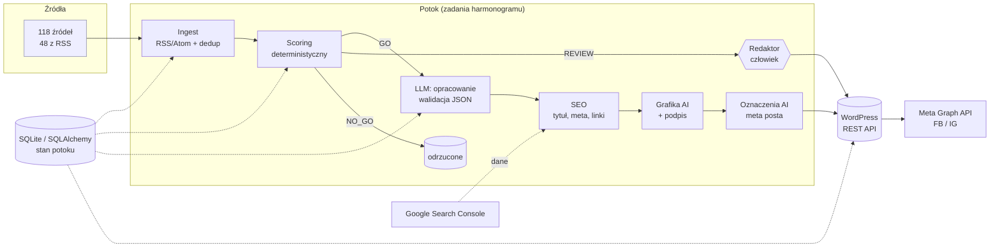

# ai-newsroom-pipeline

> **EN summary:** Case study of an AI-assisted newsroom pipeline I built and run for a Polish news portal: 118 monitored sources → deterministic scoring → LLM drafting/editing → SEO → images → WordPress REST → Meta Graph API distribution, with EU AI Act content labelling under editorial oversight. This repo contains a clean, self-contained subset of the approach (RSS ingest + dedup, scoring, LLM interface with a fake client, WordPress publisher, AI-label metadata) with 49 passing pytest tests. The production code base stays private.

Studium przypadku: zautomatyzowany potok redakcyjny dla ogólnopolskiego **portalu informacyjnego** — od monitoringu źródeł, przez ocenę i opracowanie wiadomości z pomocą LLM, po publikację w WordPressie i dystrybucję w mediach społecznościowych. Repozytorium zawiera **wybrane, uproszczone moduły** pokazujące podejście; kod produkcyjny jest prywatny.

---

## Problem

Prowadzenie portalu informacyjnego z małym zespołem wymaga:

- śledzenia ponad stu źródeł (serwisy ogólnopolskie, regionalne, samorządowe),
- szybkiego odsiewania duplikatów i wiadomości mało istotnych,
- przygotowywania tekstów w spójnym stylu, z opisem SEO, grafiką i postami do mediów społecznościowych,
- spełnienia wymogów przejrzystości dla treści tworzonych z udziałem AI.

## Rozwiązanie

Wieloetapowy potok, w którym **tanie i deterministyczne kroki odsiewają materiał, zanim trafi do LLM**, a człowiek zachowuje kontrolę redakcyjną:

1. **Ingest** — monitor RSS/Atom + rejestr źródeł; normalizacja URL, deduplikacja po adresie i podobieństwie tytułów.
2. **Scoring** — deterministyczna ocena (świeżość, zasięg źródła, unikalność, dopasowanie do profilu, potencjał SEO) z progiem GO/NO-GO; tematy wrażliwe trafiają do przeglądu człowieka (`REVIEW`), a nie do automatu.
3. **Opracowanie przez LLM** — model dostaje tylko kandydatów powyżej progu; zwraca JSON walidowany pole po polu. Model może skorygować ocenę w wąskim zakresie, ale nie decyduje sam.
4. **SEO** — tytuł/meta description, linkowanie wewnętrzne, optymalizacje oparte na danych z Google Search Console.
5. **Grafika** — generowanie ilustracji AI z obowiązkowym podpisem.
6. **Publikacja** — WordPress REST API (Application Passwords), idempotentnie po slugu.
7. **Dystrybucja** — Meta Graph API (strony Facebook / Instagram) z kartami graficznymi.
8. **Oznaczanie AI** — flagi zapisane w metadanych posta + podpisy pod grafikami; podejście oparte na art. 50 AI Act, z treścią pod kontrolą redakcyjną.

## Architektura



Każdy etap w produkcji to osobne zadanie harmonogramu z własną blokadą (żeby przebiegi się nie nakładały), logiem i monitoringiem; stan wiadomości i artykułów trzyma baza danych.

## Stack

- **Python 3.12**, SQLAlchemy (SQLite, schemat przygotowany pod PostgreSQL), `requests`
- **LLM** za wspólnym interfejsem (dostawca wymienny bez zmian w potoku)
- **WordPress** (REST API, Application Passwords, mu-pluginy), Docker
- **Meta Graph API** (publikacja na stronach FB i profilach IG)
- **Google Search Console API** (dane do optymalizacji SEO)
- Harmonogram zadań systemu + watchdogi, `pytest`

## Wyniki / skala

| Metryka | Wartość |
|---|---|
| Monitorowane źródła | **118** (48 z działającym RSS) |
| Zadania w harmonogramie | **31** |
| Testy jednostkowe w projekcie produkcyjnym | **~160** |
| Artykuły opublikowane w sierpniu 2026 | **1 615** |
| Oznaczanie treści AI | zgodnie z art. 50 AI Act, pod kontrolą redakcyjną |

## Co zawiera to repozytorium

**Zawiera** (czyste, samodzielne re-implementacje, bez danych produkcyjnych):

| Moduł | Co pokazuje |
|---|---|
| `src/newsroom/ingest.py` | parser RSS 2.0 / Atom bez zależności, normalizacja URL (usuwanie `utm_*`, `fbclid`…), deduplikacja po URL i podobieństwie tytułów (Jaccard na tokenach bez diakrytyków), izolacja awarii pojedynczego źródła |
| `src/newsroom/scoring.py` | deterministyczny scoring z wagami, progiem, priorytetem (breaking/hot/standard/evergreen) i eskalacją tematów wrażliwych do człowieka |
| `src/newsroom/llm.py` | protokół `LLMClient`, `FakeLLMClient` do testów, wyciąganie i walidacja JSON z odpowiedzi modelu, ograniczona (clamp) korekta oceny, bezpieczny fallback przy awarii |
| `src/newsroom/wp_publisher.py` | WordPress REST: szkic domyślnie, idempotencja po slugu, retry z backoffem tylko dla błędów przejściowych, upload mediów, dry-run, bezpieczna konwersja Markdown→HTML (escapowanie) |
| `src/newsroom/ai_label.py` | oznaczenia AI jako metadane obiektu + idempotentne podpisy; nota o tekście zależna od przeglądu redakcyjnego |
| `src/newsroom/pipeline.py` | złożenie kroków w jeden przebieg z raportem |
| `examples/run_demo.py` | demo offline na przykładowych kanałach |
| `tests/` | 49 testów `pytest` (HTTP mockowane, LLM podmieniony) |

**Nie zawiera** (prywatne): kodu produkcyjnego, rejestru źródeł, promptów i bazy wiedzy redakcyjnej, modułów SEO/GSC, generowania grafik, dystrybucji przez Meta Graph API, konfiguracji serwera, danych i poświadczeń.

## Uruchomienie

```bash
python -m venv .venv
# Windows: .venv\Scripts\activate    Linux/macOS: source .venv/bin/activate
pip install -r requirements-dev.txt
pytest                      # 49 passed
python examples/run_demo.py # demo offline, nic nie wysyła
```

Do pracy z prawdziwym WordPressem: `WordPressPublisher(base_url, user, app_password)` — dane z własnego `.env` (wzór: `.env.example`, wartości fikcyjne).

## Autor

**Filip Łukaszewski** — automatyzacja procesów z AI, wdrożenia, performance marketing.
filip.lukaszewski91@gmail.com

Licencja: MIT.
