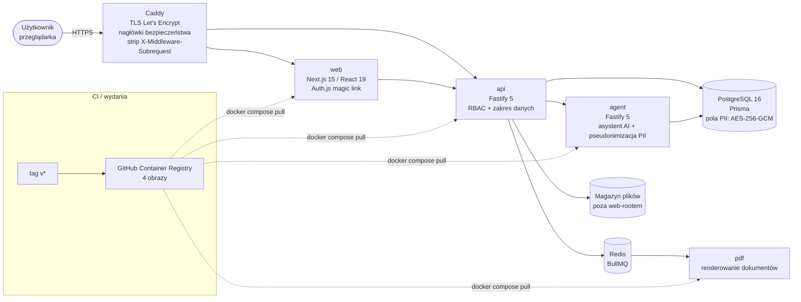

# contracts-saas-case-study

> **EN summary:** Case study of a production web app I designed and deployed for generating and managing employment contracts and annexes (PDF export, magic-link auth, AES-256-GCM encryption of personal data, role-based access, background jobs, 4 Docker images, Caddy + Let's Encrypt), including a security audit with fixes for IDOR, cross-tenant writes, RBAC gaps and the Next.js middleware bypass CVE-2025-29927. The production source is private; this repo contains the case study, the architecture and three small generic re-implementations (field encryption, RBAC guard, CVE-2025-29927 mitigation) with 38 passing vitest tests.

Studium przypadku aplikacji webowej do **generowania i zarządzania umowami pracowniczymi oraz aneksami**, działającej produkcyjnie. Kod produkcyjny jest prywatny — to repozytorium opisuje problem, architekturę i decyzje, a wybrane techniki pokazuje na **ogólnych, napisanych od nowa przykładach** z testami.

---

## Problem

Wewnętrzna aplikacja dla działu kadr i zarządu (do kilkunastu użytkowników) miała zastąpić przygotowywanie umów i aneksów poza jednym systemem. Wymagania:

- dane pracownika, stanowiska i warunków wpisywane raz i używane w kolejnych dokumentach,
- jeden rejestr umów z historią zmian (aneksy) i eksportem do PDF,
- dane osobowe i płacowe (numery identyfikacyjne, konta bankowe, adresy, wynagrodzenia) chronione również na wypadek wycieku bazy,
- jasne reguły, kto może widzieć czyje dane.

## Rozwiązanie

- **Generator umów i aneksów** z szablonów, z eksportem do **PDF** (osobna usługa renderująca).
- **Logowanie magic-linkiem** (Auth.js / NextAuth v5) — bez haseł do zapamiętania; sesje w ciasteczkach `__Secure-`.
- **Szyfrowanie danych osobowych na poziomie pól** — AES-256-GCM, klucz główny poza repozytorium i bazą, procedura odzyskiwania klucza; dane wrażliwe nie trafiają do logów (redakcja logów).
- **RBAC** — 6 ról (Admin, HR, Manager, Employee, Accountant, Viewer) plus zakres danych: firma, dział, własny dokument.
- **Zadania w tle** — BullMQ na Redisie (generowanie dokumentów, przetwarzanie plików).
- **Walidacja uploadu** — whitelist typów MIME, weryfikacja sygnatur plików (magic bytes), ochrona przed path traversal w nazwach plików.
- **Moduł asystenta AI** z **pseudonimizacją danych osobowych** przed wysłaniem treści do modelu.
- **Wdrożenie**: 4 obrazy Docker (web, api, agent, pdf) budowane z tagów wersji i publikowane w **GitHub Container Registry**, Docker Compose, **Caddy** jako reverse proxy z automatycznymi certyfikatami **Let's Encrypt** i nagłówkami bezpieczeństwa (HSTS, CSP, nosniff, Permissions-Policy).

## Architektura



## Stack

**Frontend:** Next.js 15, React 19, Auth.js (NextAuth v5)
**Backend:** Fastify 5, Prisma, PostgreSQL 16, Redis + BullMQ
**Infrastruktura:** Docker / Docker Compose, GitHub Container Registry, Caddy + Let's Encrypt
**Jakość:** monorepo pnpm + Turborepo, TypeScript, testy jednostkowe (Vitest)

## Audyt bezpieczeństwa i poprawki

Po wdrożeniu produkcyjnym przeprowadziłem audyt w pięciu obszarach: uwierzytelnianie, wstrzyknięcia, XSS/CSRF, zależności, infrastruktura. Najważniejsze znaleziska i poprawki:

| Obszar | Problem | Poprawka |
|---|---|---|
| **IDOR** | pobieranie plików po identyfikatorze bez sprawdzenia, czy plik należy do zakresu użytkownika | kontrola dostępu na podstawie atrybutów zasobu z bazy (firma, rola), `nosniff` |
| **Zapis między firmami** | tworzenie/edycja rekordów z identyfikatorem firmy spoza zakresu użytkownika | walidacja zakresu docelowego przy każdym zapisie (`COMPANY_FORBIDDEN`) |
| **RBAC** | endpointy konfiguracyjne dostępne szerzej niż dla administratora; rola przy logowaniu nadawana zbyt szeroko | guard roli `Admin` + blokada ścieżek na reverse proxy; rola pobierana z konta, nieznany użytkownik = brak dostępu |
| **Fail-closed** | deweloperski przełącznik wyłączający logowanie | w środowisku produkcyjnym ignorowany niezależnie od konfiguracji |
| **CVE-2025-29927** | obejście middleware Next.js nagłówkiem `x-middleware-subrequest` | usuwanie nagłówka na reverse proxy + autoryzacja w API niezależna od middleware |
| **Sekrety i logi** | ryzyko trafienia plików z kluczami do repozytorium/obrazu; dane w logach | `.gitignore` + `.dockerignore`, redakcja pól w logach, dłuższy sekret sesji |

Opis podatności CVE-2025-29927 i obrony w głąb: [`docs/cve-2025-29927.md`](docs/cve-2025-29927.md).

## Co zawiera to repozytorium

**Zawiera** — ogólne przykłady napisane od nowa (nie kod produkcyjny):

| Plik | Co pokazuje |
|---|---|
| `src/crypto/fieldEncryption.ts` | AES-256-GCM dla pojedynczych pól: losowy IV, tag uwierzytelniający, **AAD wiążące szyfrogram z rekordem i polem**, keyring z identyfikatorem klucza i **rotacją** (`needsRotation`, `reencrypt`) |
| `src/auth/rbac.ts` | macierz uprawnień 6 ról + zakres (firma / dział / własność) jako ochrona przed IDOR, guard dla handlerów (403 zamiast 404 dla cudzych zasobów), przełącznik deweloperski fail-closed |
| `src/security/nextMiddlewareBypass.ts` | filtr nagłówków wewnętrznych + sprawdzenie, czy wersja Next.js jest podatna na CVE-2025-29927 (np. jako krok CI) |
| `examples/Caddyfile` | przykładowa konfiguracja reverse proxy z hardeningiem (domena fikcyjna) |
| `*.test.ts` | 38 testów Vitest |

**Nie zawiera:** kodu źródłowego aplikacji, schematu bazy, szablonów umów, danych, konfiguracji serwera, adresów, kluczy ani poświadczeń.

## Uruchomienie

Wymagany Node.js 20+.

```bash
npm install
npm test           # vitest run — 38 passed
npm run typecheck  # tsc --noEmit
```

## Autor

**Filip Łukaszewski** — projekt, implementacja i wdrożenie; automatyzacja procesów z AI.
filip.lukaszewski91@gmail.com

Licencja: MIT.
