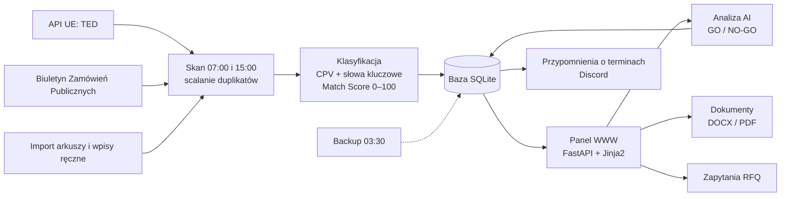

# tender-panel-case-study

> **EN summary:** Case study of a tender management panel I built and run in production since 08.2026 for my company Cognify. It pulls public tenders from the EU TED API and the Polish Public Procurement Bulletin (BZP), classifies them by CPV codes and keywords, scores the fit (0–100), runs an AI analysis with a GO / NO-GO recommendation, tracks each tender through a sales pipeline and generates offer documents (DOCX / PDF). Over 1 800 tenders in the database. Stack: Python, FastAPI, SQLite, Jinja2, Claude (headless), Caddy. The source code is private; this repo describes how the system works, with diagrams.

Studium przypadku panelu przetargowego, który zbudowałem i utrzymuję dla Cognify Sp. z o.o. Panel działa produkcyjnie od sierpnia 2026. Kod jest prywatny, więc w tym repozytorium opisuję, jak system działa i jak jest zbudowany. Nie ma tu kodu źródłowego ani danych.

---

## Problem

Firma startuje w przetargach publicznych w czterech obszarach: IT, marketing, okna i drzwi. Ogłoszenia są rozproszone po kilku serwisach. Ręczne przeglądanie zabierało dużo czasu, a decyzja „startujemy czy nie” i przygotowanie dokumentów odbywały się poza jednym miejscem.

Potrzebne było jedno narzędzie, które:

- samo zbiera nowe ogłoszenia i odrzuca te, które nas nie dotyczą,
- ocenia, jak bardzo przetarg pasuje do firmy,
- pomaga szybko podjąć decyzję GO / NO-GO,
- prowadzi przetarg przez kolejne etapy, aż do złożenia oferty,
- generuje dokumenty ofertowe z danymi właściwej spółki.

## Co robi panel

| Moduł | Opis |
|---|---|
| **Pozyskiwanie** | Dwa razy dziennie (07:00 i 15:00) pobiera ogłoszenia z API UE (TED) i z Biuletynu Zamówień Publicznych. To samo postępowanie z dwóch źródeł jest scalane w jeden rekord. |
| **Klasyfikacja i Match Score** | Przypisuje przetarg do jednego z czterech obszarów i liczy dopasowanie w skali 0–100 na podstawie kodów CPV i słów kluczowych. Oczywiste przetargi spoza branży (np. roboty drogowe, catering) dostają karę. |
| **Analiza AI** | Na żądanie model Claude przygotowuje streszczenie, dopasowanie, listę brakujących informacji, ryzyka i rekomendację GO / NO-GO. |
| **Pipeline** | Etapy: nowy, research, kwalifikacja, zapytanie, oferta, złożone, wygrane / przegrane / odrzucone. Po terminie przetarg sam trafia do archiwum. |
| **Zapytania (RFQ)** | Wnioski o wyjaśnienie treści SWZ do zamawiającego i zapytania ofertowe do dostawców i partnerów. |
| **Dokumenty** | 7 typów dokumentów, generowanych per przetarg i per spółka, z eksportem do DOCX i PDF. |
| **Przypomnienia** | Powiadomienia na Discordzie 7, 3 i 1 dzień przed terminem składania ofert. |
| **Konta** | Role administrator i użytkownik, zakładanie kont, reset hasła, wymuszona zmiana hasła startowego. |

## W liczbach

- ponad **1 800 postępowań** w bazie (od sierpnia do końca października 2026): ok. 1 190 z TED, ok. 560 z BZP, reszta z importu arkuszy i wpisów ręcznych,
- ok. **800 przetargów** z wysokim dopasowaniem (Match Score 75+),
- **7 typów** dokumentów ofertowych, eksport DOCX i PDF,
- **31 testów** automatycznych, uruchamianych na tymczasowej bazie,
- codzienny backup bazy z kontrolą spójności.

## Schemat systemu

Więcej szczegółów:

- [Przepływ przetargu](./docs/przeplyw-przetargu.md): od ogłoszenia do złożonej oferty
- [Klasyfikacja i Match Score](./docs/klasyfikacja.md): jak panel ocenia dopasowanie
- [Analiza AI](./docs/analiza-ai.md): co dostaje model i co zwraca
- [Architektura i bezpieczeństwo](./docs/architektura.md): komponenty, zadania cykliczne, logowanie, model danych

## Technologie

`Python` `FastAPI` `SQLite` `Jinja2` `Claude (tryb headless)` `python-docx` `PDF z przeglądarki headless` `Caddy` `Let's Encrypt` `pytest` `Harmonogram zadań Windows` `Discord webhook`

## Czego tu nie ma

Kodu źródłowego, bazy, danych zamawiających, adresów serwerów, kont i haseł. Opisuję działanie i budowę systemu, nie publikuję implementacji.

---

Autor: Filip Łukaszewski · [główne repozytorium](../README.md)
