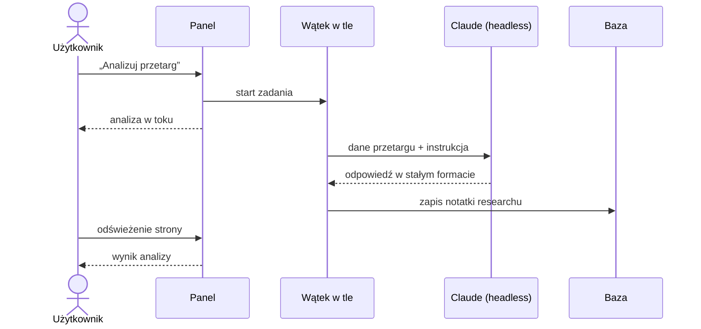

# Analiza AI

Analizę uruchamia się przyciskiem przy przetargu. Panel wysyła do modelu Claude dane ogłoszenia, a wynik zapisuje jako notatkę researchu.

## Co dostaje model

Tytuł, zamawiającego, opis, kody CPV, lokalizację, wartość szacunkową, terminy, obszar i Match Score z klasyfikacji.

## Co zwraca

Odpowiedź ma zawsze te same sekcje:

1. **Streszczenie:** co zamawiający kupuje i czy to nasz teren.
2. **Dopasowanie do obszarów:** który obszar i dlaczego, albo że żaden.
3. **Czego brakuje w danych:** co trzeba sprawdzić ręcznie w ogłoszeniu lub SWZ (warunki udziału, wadium, doświadczenie, terminy).
4. **Ryzyka:** konkretne, np. wymóg referencji o określonej wartości albo krótki termin realizacji.
5. **Rekomendacja GO / NO-GO:** jedno słowo, 2–3 zdania uzasadnienia i pierwszy krok.

## Zasady, które pilnują jakości

- Model odpowiada tylko na podstawie przekazanych danych. Nie ma dostępu do narzędzi, plików ani internetu.
- Nie może wymyślać warunków udziału, wadium ani terminów. Jeśli czegoś nie ma w danych, ma to napisać wprost.
- Kwoty i terminy podaje tylko wtedy, gdy wynikają z ogłoszenia.
- Analiza trwa 40–150 sekund, więc działa w tle i nie blokuje panelu.

Rekomendacja AI to podpowiedź. Decyzję GO / NO-GO podejmuje człowiek.
