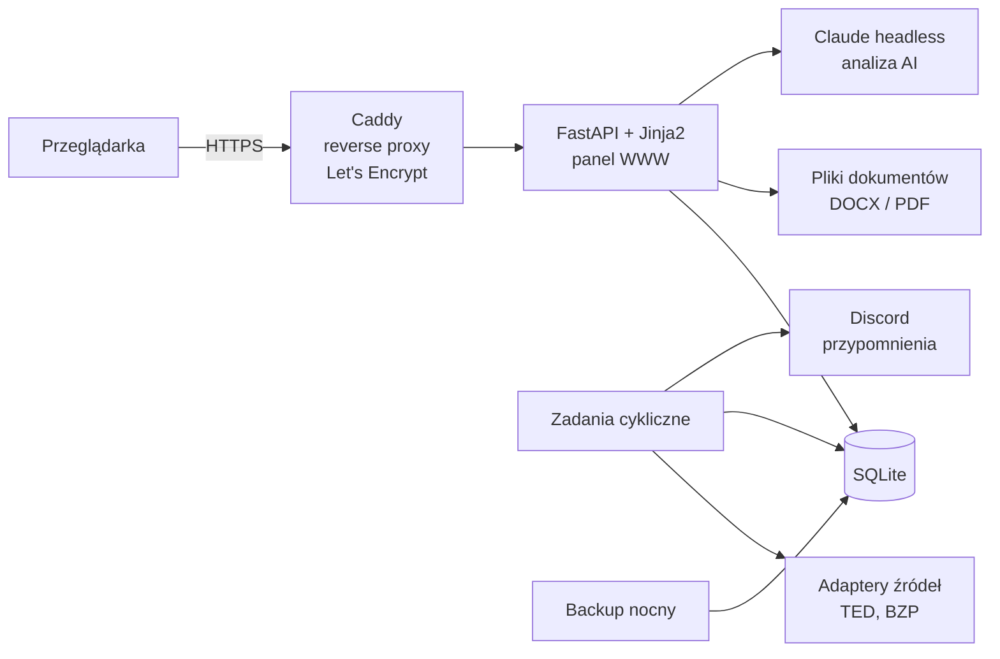
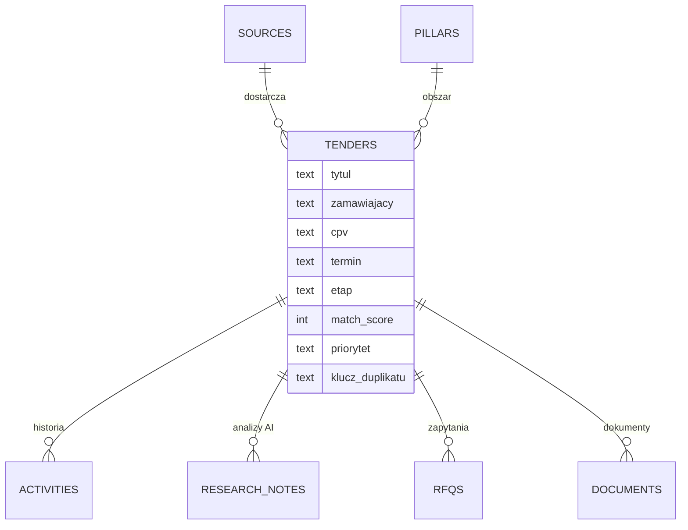

# Architektura i bezpieczeństwo

## Komponenty

Panel to jedna aplikacja FastAPI z szablonami Jinja2, bez osobnego frontendu. Jedynym źródłem prawdy jest baza SQLite. Do panelu prowadzi z internetu tylko Caddy z automatycznym certyfikatem, a aplikacja nasłuchuje wyłącznie lokalnie.

## Zadania cykliczne

| Zadanie | Kiedy | Co robi |
|---|---|---|
| Panel | start serwera | uruchamia aplikację |
| Skan | 07:00 i 15:00 | pobiera nowe ogłoszenia, przenosi przetargi po terminie do archiwum, wysyła przypomnienia |
| Backup | 03:30 | kopia bazy z kontrolą spójności, rotacja: 7 dziennych, 4 tygodniowe, 12 miesięcznych |

## Źródła i rozszerzalność

Każde źródło to osobny adapter z jednym zadaniem: zamienić ogłoszenia z danego serwisu na wspólny format. Aktywne są dwa:

- **TED** (UE): otwarte API, filtr po kodach CPV i miejscu realizacji w Polsce,
- **BZP**: otwarte API serwisu e-Zamówienia.

Kolejne źródła (m.in. Baza Konkurencyjności i platformy zakupowe wymagające logowania) są zapisane w panelu jako planowane albo ręczne. Nowe źródło to nowy adapter i wpis w rejestrze, a skan sam je podchwyci po włączeniu.

API BZP ma kilka nieopisanych ograniczeń, które ustaliłem na próbach: małą maksymalną liczbę wyników na stronę, wymagany format nazw pól sortowania, filtr dat działający tylko jako para „od–do” i ignorowaną frazę wyszukiwania. Dlatego filtrowanie panel robi u siebie.

## Model danych

Do tego tabele ustawień (m.in. profile spółek do dokumentów) i dziennik logowań. Zmiany schematu idą przez migracje, żeby nowe kolumny trafiały też do istniejącej bazy.

## Bezpieczeństwo

- logowanie tylko w aplikacji, role administrator i użytkownik,
- hasła haszowane PBKDF2 (200 tys. iteracji), wymuszona zmiana hasła startowego,
- sesja w ciasteczku HttpOnly, Secure, SameSite=Lax,
- ochrona CSRF na wszystkich formularzach,
- limit prób logowania osobno dla adresu IP i dla loginu, dziennik logowań,
- sekrety (poczta, webhooki) trzymane poza repozytorium,
- wysyłka maili do zamawiających i dostawców domyślnie wyłączona, włącza ją człowiek.

Jedna rzecz wyszła dopiero na produkcji: proxy przekazywało do aplikacji adres klienta razem z numerem portu. Każde połączenie miało więc inny klucz i limit prób logowania na IP nigdy się nie włączał. Po poprawce proxy przekazuje sam adres IP.

## Testy

31 testów automatycznych (pytest) na tymczasowej bazie, bez dotykania produkcji. Sprawdzają m.in. klasyfikację i kody CPV, scalanie duplikatów między źródłami, logowanie, CSRF i limit prób, archiwizację i jednorazowe przypomnienia, generowanie dokumentów i zapytań oraz to, że wysyłka maili jest domyślnie wyłączona.
