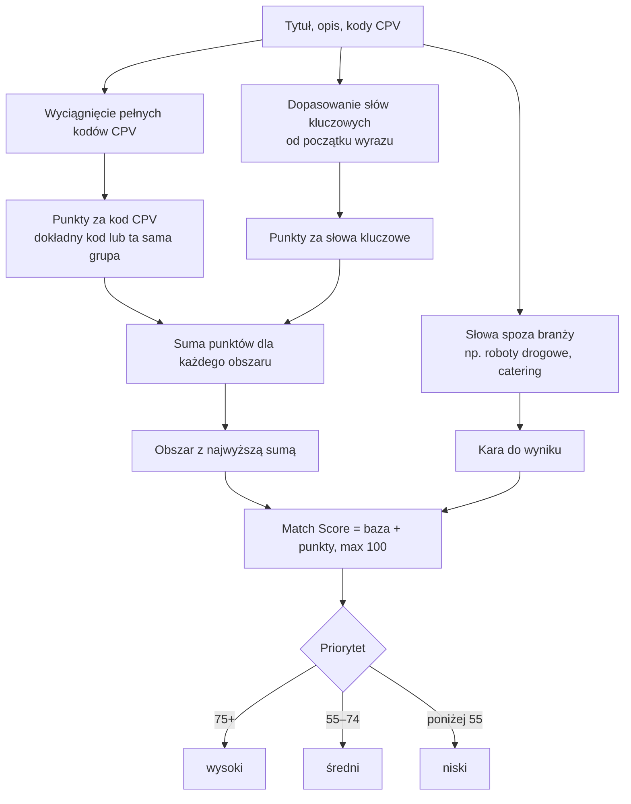

# Klasyfikacja i Match Score

Każdy nowy przetarg dostaje obszar (IT, marketing, okna, drzwi), wynik dopasowania 0–100 i priorytet. Ocena jest prosta i przewidywalna: te same dane zawsze dają ten sam wynik, a każdą ocenę da się wyjaśnić.

## Dwie pułapki, które trzeba było rozwiązać

**Kody CPV porównywane w całości.** Pierwsza wersja szukała fragmentu kodu w tekście. Grupa usług IT pojawiała się wtedy w środku zupełnie innego kodu (np. akcesoriów komputerowych) i takie ogłoszenia lądowały w IT. Teraz panel wyciąga z ogłoszenia pełne, 8-cyfrowe kody i porównuje je jako całość albo jako grupę (pierwsze 4 cyfry).

**Słowa kluczowe od początku wyrazu.** Przy szukaniu fragmentu słowa krótkie hasła łapały przypadkowe wyrazy: „it” trafiało w „monitoring”, a „drzwi” w „odrzwi”. Teraz słowo musi zaczynać wyraz, a końcówka może być dowolna, więc działa polska odmiana. Ze słownika marketingu wypadło też zbyt krótkie hasło, które robiło marketing z każdej przebudowy.

## Dlaczego nie AI od razu

Skan działa dwa razy dziennie na wszystkich nowych ogłoszeniach. Reguły liczą wynik od razu i bez kosztów, a ich ocenę łatwo sprawdzić. AI wchodzi dopiero na etapie researchu, dla przetargów, które przeszły wstępne sito. Moduł klasyfikacji jest jednak tak wydzielony, że można go wymienić na model bez zmian w reszcie systemu.

## Duplikaty

To samo postępowanie bywa w TED i w BZP. Panel buduje klucz z tytułu i zamawiającego i przy zgodności łączy wpisy w jeden przetarg.
