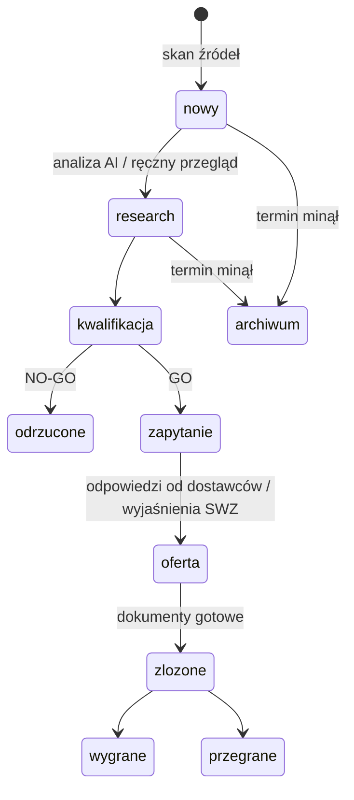

# Przepływ przetargu

Każdy przetarg w panelu ma etap. Część zmian robi automat, część człowiek.

## Krok po kroku

1. **Nowy.** Skan dodaje ogłoszenie z tytułem, zamawiającym, kodami CPV, terminem, wartością (jeśli jest) i linkiem do źródła. Od razu dostaje obszar, Match Score i priorytet (wysoki, średni, niski).
2. **Research.** Na liście przetargów filtruję po obszarze, źródle, etapie i frazie. Dla obiecujących uruchamiam analizę AI. Liczy się w tle 40–150 sekund, a wynik zapisuje się przy przetargu.
3. **Kwalifikacja.** Decyzja GO / NO-GO. Pomaga w niej wewnętrzna karta kwalifikacji, generowana jak inne dokumenty.
4. **Zapytanie.** Panel przygotowuje wniosek o wyjaśnienie SWZ albo zapytanie do dostawcy lub podwykonawcy. Wysyłka maili jest domyślnie wyłączona i panel robi tylko przebieg na sucho. Włącza ją człowiek w konfiguracji, bo po drugiej stronie są prawdziwi zamawiający i dostawcy.
5. **Oferta.** Generowanie dokumentów z danymi wybranej spółki (Cognify albo PFL Group):
   - formularz ofertowy,
   - oświadczenie o spełnianiu warunków udziału,
   - oświadczenie o braku podstaw wykluczenia,
   - wykaz usług i dostaw (doświadczenie),
   - pełnomocnictwo,
   - pismo przewodnie,
   - karta kwalifikacji GO / NO-GO (wewnętrzna).

   Każdy dokument można pobrać jako DOCX do dalszej edycji albo jako PDF.
6. **Złożone, wygrane, przegrane.** Wynik zapisany przy przetargu, razem z historią działań i notatkami.

Przetargi, które zostały na etapie „nowy” lub „research”, po terminie składania ofert trafiają automatycznie do archiwum. Dzięki temu lista robocza pokazuje tylko to, co jeszcze można złożyć.

## Przypomnienia

Dla przetargów w otwartych etapach panel wysyła powiadomienie na Discordzie 7, 3 i 1 dzień przed terminem. Każde przypomnienie idzie tylko raz.
